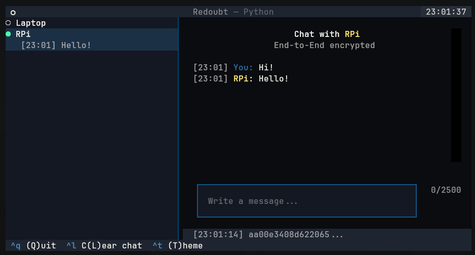

# Redoubt

<p align="center">
  
  
  
  
</p>

<p align="center">
  <a href="https://github.com/FreyFlyy/Redoubt/releases/latest">
    
  </a>
</p>



**Redoubt** is a Linux peer-to-peer messaging application built around end-to-end encryption, authenticated peer communication and encrypted local storage.

It is designed to minimize the information exposed to network observers and reduce the amount of sensitive data accessible through offline storage inspection.

The application uses a terminal-based interface powered by Textual and a modular Python architecture.

> **Security status:** Redoubt is an actively developed project. Its security mechanisms have implementation limitations and have not been presented as an independently audited cryptographic protocol. Read the threat model before relying on it for sensitive communications.

---

## Features

- **Peer-to-peer communication:** Direct communication between known contacts.
- **End-to-end encryption:** Cryptographic protection of message contents.
- **Authenticated peers:** Static public-key authentication during connection establishment.
- **Encrypted identity:** Local identity protected by a vault passphrase.
- **Encrypted storage:** SQLCipher-backed database with additional protection for sensitive fields.
- **Network traffic padding:** Fixed-size packet framing to reduce information leaked through packet sizes.
- **Contact management:** Add, list and revoke contacts.
- **Secure memory (best effort):** Memory locking and buffer zeroization.
- **Terminal interface:** Interactive TUI built with Textual.

## Architecture

Redoubt separates its functionality into independent modules:

| Module | Responsibility |
|---|---|
| `app.py` | Application entry point and orchestration |
| `crypto.py` | Cryptographic primitives and key derivation |
| `ratchet.py` | Double Ratchet: session key derivation and forward-secure message keys |
| `identity.py` | Local identity and vault management |
| `network.py` | Peer-to-peer networking |
| `protocol.py` | Communication protocol and packet handling |
| `storage.py` | Encrypted persistent storage |
| `secure_memory.py` | Memory locking and buffer zeroization |
| `ratelimit.py` | Rate limiting |
| `logger.py` | Logging |
| `themes.py` | Interface themes |
| `ui.py` | Terminal user interface |

For a detailed explanation of the implementation, protocol design, trust assumptions and security limitations, see [ARCHITECTURE.md](./ARCHITECTURE.md).

---

## Security model

Redoubt focuses on protecting communications and locally stored information against specific classes of threats.

### What Redoubt is designed to protect against

| Threat | Protection |
|---|---|
| Passive network interception | Message contents and protocol fields are encrypted before transmission. |
| Packet-size analysis | Packets are padded to fixed-size 4096-byte blocks. |
| Unauthorized peer authentication | Static public-key authentication requires knowledge of the expected peer key. |
| Offline database inspection | SQLCipher database encryption and additional field-level encryption. |
| Offline identity theft | Identity material is protected by a passphrase-derived vault key using Argon2id. |
| Compromised contacts | Explicit contact revocation with proof of possession of the corresponding public key. |

### Known limitations

Redoubt does not currently provide all the security properties of mature messaging protocols.

- **Runtime compromise:** An attacker with access to the running process can potentially access sensitive information in memory.
- **Memory management:** Memory locking and zeroization are best-effort measures. Python objects and copies of sensitive keys can exist outside protected buffers.
- **Network metadata:** IP addresses, communication timing, packet counts and communication patterns remain observable.
- **Trust establishment:** Initial contact verification requires an out-of-band fingerprint exchange. Cryptography cannot independently establish that a public key belongs to the intended person.
- **No protection against a compromised endpoint:** An attacker controlling the operating system or running process is outside the protection provided by the application.

These limitations are deliberate and documented rather than hidden behind broad security claims.

For the complete analysis, consult [ARCHITECTURE.md](./ARCHITECTURE.md).

---

## Installation

> ⚠️ **Experimental and unaudited.** Redoubt uses a custom protocol and a
> hand-assembled cryptographic design that no third party has reviewed.
> Do not use it for data whose exposure would cause harm.
> Known limits: [Security model](#security-model) · Report a vulnerability: [SECURITY.md](./SECURITY.md)

### AppImage

Redoubt is distributed as a standalone AppImage for Linux.

AppImages bundle the application and its Python dependencies, allowing Redoubt to run without manually installing Python packages or configuring a virtual environment.

1. Download the latest AppImage from [GitHub Releases](https://github.com/FreyFlyy/Redoubt/releases) (NOTE: only x86_64 architecture is compiled, follow [Building from source](#building-from-source) for other systems).
2. Make the file executable:

```bash
chmod +x Redoubt-2.0.0-*.AppImage
```

**Note:** AppImage compatibility depends on the host system's architecture and available system libraries. Some distributions may require FUSE support.

### Post-installation

The following steps integrate Redoubt into your desktop environment, allowing it to appear in the application menu.

#### 1. Create the application directory

```bash
mkdir -p ~/.redoubt
mkdir -p ~/.local/share/applications
```

#### 2. Copy the AppImage and icon

Copy the AppImage matching your system architecture and the application icon into `~/.redoubt`:

```bash
cp Redoubt-2.0.0-x86_64.AppImage ~/.redoubt/  # x86_64

cp ./packaging/redoubt.png ~/.redoubt/
```

#### 3. Make the AppImage executable

```bash
chmod +x ~/.redoubt/Redoubt-2.0.0-*.AppImage
```

#### 4. Install the desktop entry

```bash
nano ~/.local/share/applications/Redoubt.desktop
```

Configure the `Exec` and `Icon` fields using the absolute paths to your files.

Example for x86_64:

```ini
[Desktop Entry]
Version=2.0.0
Type=Application
Name=Redoubt
Comment=A peer-to-peer messaging app with end-to-end message encryption and hardened client runtime
Exec=/home/USERNAME/.redoubt/Redoubt-2.0.0-x86_64.AppImage
Icon=/home/USERNAME/.redoubt/redoubt.png
Terminal=true
Categories=Network
StartupNotify=false
```

Replace `USERNAME` with your Linux username.

**Important:** Desktop entries require absolute paths. Do not use `~` in the `Exec` or `Icon` fields.

#### 5. Update the application database

```bash
update-desktop-database ~/.local/share/applications
```

The desktop environment should now recognize Redoubt in its application menu. If it does not appear immediately, refresh the application menu or log out and back in.

---

## Building from source

### Requirements

- Linux system.
- Python 3.12 or newer.
- pip and Python virtual environment support.
- Git.
- AppImageKit's `appimagetool`.
- Native development libraries required by SQLCipher and Python dependencies.

### 1. Install system dependencies

**Debian / Ubuntu**

```bash
sudo apt update
sudo apt install -y \
    python3 \
    python3-pip \
    python3-venv \
    python-is-python3 \
    python3-dev \
    build-essential \
    libsqlcipher-dev \
    libssl-dev \
    libffi-dev \
    squashfs-tools \
    zsync \
    wget \
    desktop-file-utils
```

**Fedora / RHEL**

```bash
sudo dnf install -y \
    python3 \
    python3-pip \
    python3-devel \
    gcc \
    gcc-c++ \
    make \
    sqlcipher-devel \
    openssl-devel \
    libffi-devel \
    squashfs-tools \
    zsync \
    wget \
    desktop-file-utils
```

**Arch Linux and derivatives**

```bash
sudo pacman -S --needed \
    python \
    python-pip \
    base-devel \
    sqlcipher \
    openssl \
    libffi \
    squashfs-tools \
    zsync \
    wget \
    desktop-file-utils
```

Ensure that the installed Python version is at least 3.12:

```bash
python --version
```

### 2. Install appimagetool

`appimagetool` is required to package the generated AppDir into an AppImage.

```bash
sudo wget -O /usr/local/bin/appimagetool \
    https://github.com/AppImage/appimagetool/releases/download/continuous/appimagetool-x86_64.AppImage

sudo chmod +x /usr/local/bin/appimagetool
```

Verify the installed binary:

```bash
file /usr/local/bin/appimagetool
```

If AppImage execution fails because FUSE is unavailable, install the appropriate FUSE compatibility package or use the AppImage extraction mode supported by the runtime.

### 3. Clone the repository

```bash
git clone https://github.com/FreyFlyy/Redoubt.git
cd Redoubt
```

### 4. Build the AppImage

Build for the current machine's architecture.

**x86_64**

```bash
ARCH=x86_64 ./packaging/build-appimage.sh
```

**ARM64**

```bash
ARCH=aarch64 ./packaging/build-appimage.sh
```

The build script automatically:

1. Creates an isolated Python virtual environment.
2. Installs Redoubt and its Python dependencies.
3. Installs PyInstaller.
4. Generates a standalone executable.
5. Creates the AppDir structure.
6. Packages the application using `appimagetool`.

The resulting AppImage is placed in `/`.

**Important:** Build each architecture natively on a machine with the corresponding architecture. Building on x86_64 does not automatically produce an ARM64 executable, and vice versa.

---

## Usage

Launch Redoubt:

```bash
./Redoubt-2.0.0-*.AppImage
```

On first launch, Redoubt will request a vault passphrase and initialize a local identity.

### Identity

Display your identity card:

```bash
./Redoubt-2.0.0-*.AppImage --show-card
```

Share your public identity information with the intended contact through an independent channel.

### Contact management

Add a contact:

```bash
./Redoubt-2.0.0-*.AppImage --add-contact
```

List contacts:

```bash
./Redoubt-2.0.0-*.AppImage --list-contacts
```

Remove a contact:

```bash
./Redoubt-2.0.0-*.AppImage --remove-contact
```

**Important:** Verify contact fingerprints independently before establishing trust. Never assume that receiving a public key automatically authenticates its owner.

---

## Roadmap

### V2.1.0 — Tor/onion net

- Optional Tor/onion networking.
- Separation of LAN and onion contacts.

### V3.0.0 or more — System-level improvements

- Rewrite security-critical components in a memory-safe language.
- More explicit control over cryptographic key lifetimes.
- Improved protection of sensitive material in RAM.
- Timing obfuscation and dummy traffic.
- Further reduction of network metadata leakage.

---

## Technical documentation

For additional implementation details, see:

- [ARCHITECTURE.md](./ARCHITECTURE.md) — Internal architecture, cryptographic design, protocol and security limitations.
- [LICENSE](./LICENSE) — Project license.

---

## Main technologies

- **Python 3.12+** — Application implementation.
- **Cryptography** — X25519, HKDF, AES-GCM and Argon2id.
- **SQLCipher** — Encrypted SQLite storage.
- **Textual** — Terminal user interface.
- **PyInstaller** — Standalone application packaging.

---

## Author

**Francesco Scolz**

- GitHub: [@FreyFlyy](https://github.com/FreyFlyy)
- LinkedIn: [Francesco Scolz](https://www.linkedin.com/in/francesco-scolz)
- Hugging Face: [@FreyFlyy](https://huggingface.co/FreyFlyy)

---

## License

Redoubt is distributed under the **GNU Affero General Public License v3.0 only (AGPL-3.0-only)**.

See [LICENSE](./LICENSE) for the full license text.
